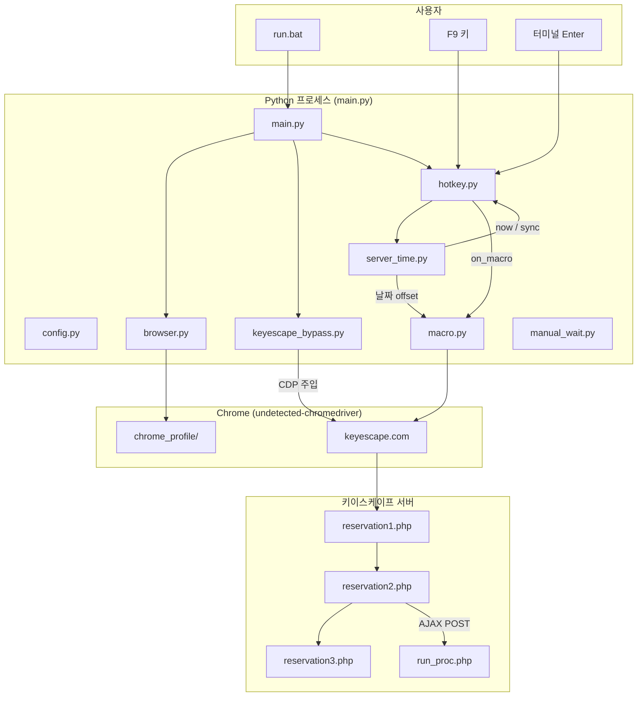
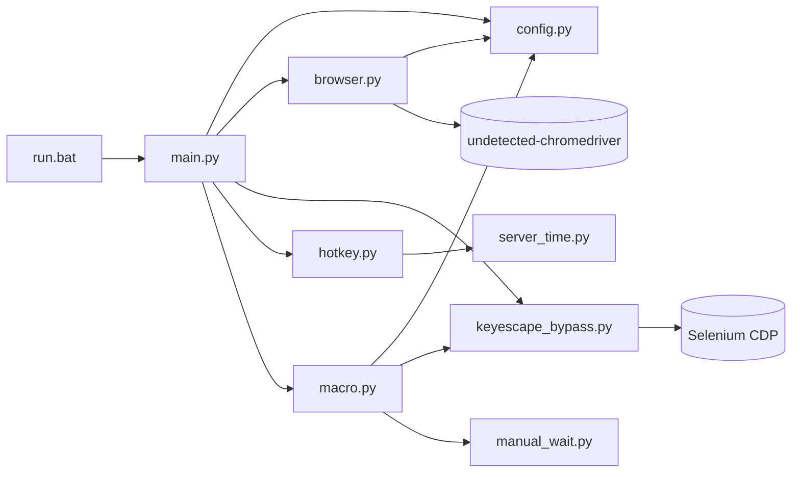
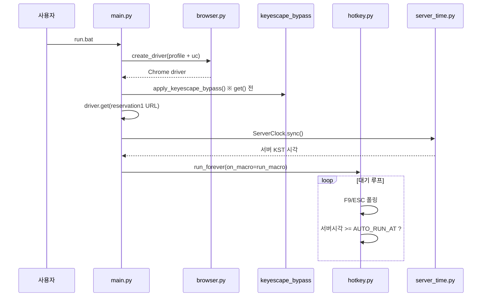
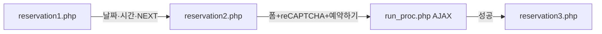
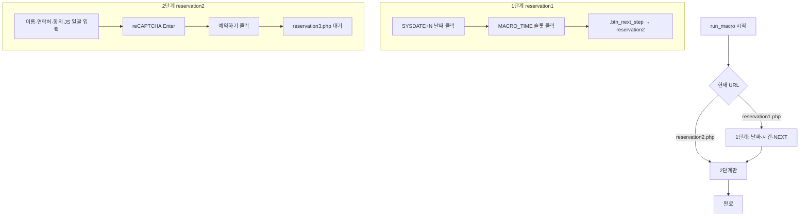
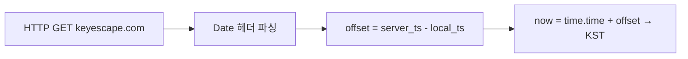
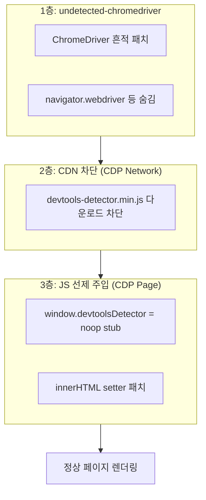
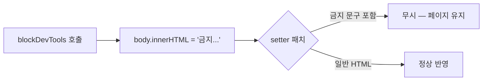
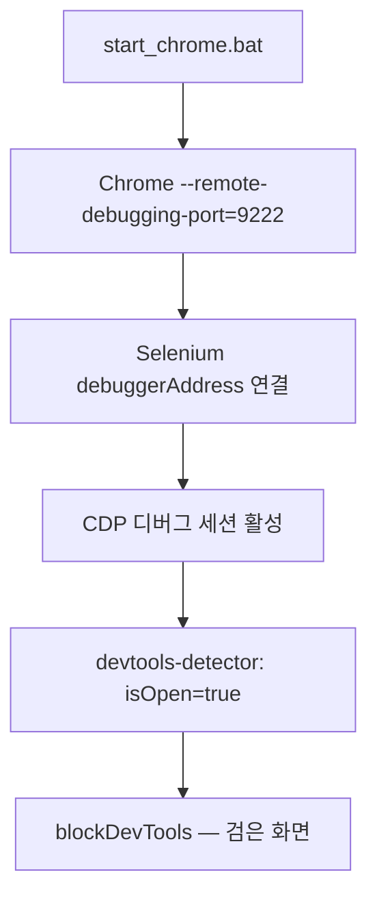
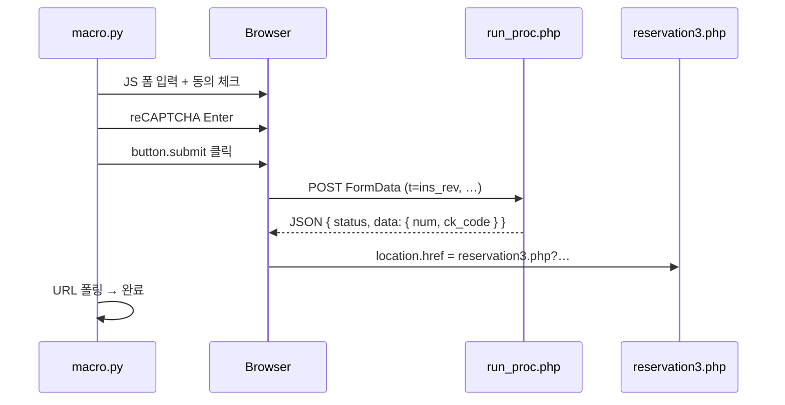

# Keyscape 예약 매크로 — 아키텍처 & 기술 문서

> [keyescape.com](https://www.keyescape.com) 방탈출 예약을 자동화하는 Selenium 매크로 프로젝트  
> Python + undetected-chromedriver + CDP 우회 + 서버 시각 스케줄링

---

## 목차

1. [한 줄 요약](#1-한-줄-요약)
2. [전체 아키텍처](#2-전체-아키텍처)
3. [모듈 구성](#3-모듈-구성)
4. [실행 흐름](#4-실행-흐름)
5. [예약 매크로 상세](#5-예약-매크로-상세)
6. [서버 시각 자동 실행](#6-서버-시각-자동-실행)
7. [개발자도구 탐지 우회 (핵심)](#7-개발자도구-탐지-우회-핵심)
8. [기술 스택 & 설계 원칙](#8-기술-스택--설계-원칙)
9. [설정 가이드 (config.py)](#9-설정-가이드-configpy)
10. [실행 방법](#10-실행-방법)
11. [트러블슈팅](#11-트러블슈팅)

---

## 1. 한 줄 요약

```
run.bat → Chrome(uc) 실행 → devtools 우회 주입 → 예약 페이지 접속
       → F9 / 서버시각 04:06 / Enter → macro.py가 1~3단계 예약 자동 수행
```

키이스케이프는 **Selenium(ChromeDriver) 사용 자체를 개발자도구로 간주**해 페이지를 차단한다.  
그래서 **3겹 방어**를 쓴다:

| 계층 | 역할 |
|------|------|
| `undetected-chromedriver` | ChromeDriver/Selenium 흔적 최소화 |
| `keyescape_bypass.py` | 사이트 devtools-detector 무력화 |
| `profile` 모드 | 디버그 포트(9222) attach 금지 |

---

## 2. 전체 아키텍처

### 2.1 시스템 구성도



### 2.2 레이어 구조

```
┌─────────────────────────────────────────────────────────┐
│  Presentation   run.bat, CLI (--auto-at, --once, …)     │
├─────────────────────────────────────────────────────────┤
│  Orchestration  main.py — 세션 시작, bypass, hotkey 루프 │
├─────────────────────────────────────────────────────────┤
│  Automation     macro.py — UI 클릭/입력/제출             │
│  Scheduling     hotkey.py + server_time.py              │
├─────────────────────────────────────────────────────────┤
│  Browser        browser.py — uc Chrome 생성              │
│  Bypass         keyescape_bypass.py — CDP 2단계 우회     │
├─────────────────────────────────────────────────────────┤
│  Config         config.py — URL, 시간, 예약자 정보       │
└─────────────────────────────────────────────────────────┘
```

### 2.3 파일 의존 관계



---

## 3. 모듈 구성

| 파일 | 역할 |
|------|------|
| `run.bat` | venv Python으로 `main.py` 실행 |
| `main.py` | CLI 파싱, Chrome 세션, bypass 적용, hotkey 루프 |
| `config.py` | **모든 설정의 단일 진실(Single Source of Truth)** |
| `browser.py` | `undetected-chromedriver` / attach / standard Chrome 생성 |
| `keyescape_bypass.py` | devtools-detector CDN 차단 + JS stub + innerHTML 방어 |
| `macro.py` | 예약 1→2→3단계 자동화 (F9 트리거) |
| `hotkey.py` | F9/ESC 폴링, 터미널 Enter, 서버 시각 자동 실행 |
| `server_time.py` | HTTP `Date` 헤더 → KST, offset 기반 `now()` |
| `manual_wait.py` | reCAPTCHA Enter 키 전송 유틸 |
| `tab_utils.py` | attach 모드 탭 선택 (키이스케이프 비권장) |
| `start_chrome.bat` | 디버그 Chrome (9222) — **키이스케이프 사용 금지** |

---

## 4. 실행 흐름

### 4.1 앱 시작 ~ 대기



### 4.2 매크로 트리거

| 트리거 | 동작 |
|--------|------|
| **F9** | Windows `GetAsyncKeyState` 폴링 |
| **터미널 Enter** | 별도 daemon 스레드 `input()` |
| **서버 시각** | `AUTO_RUN_AT` (예: 04:06 KST) 도달 시 자동 |

> Selenium 호출은 **반드시 메인 스레드**에서만 실행 (`hotkey.py` → `on_macro()` 콜백).

### 4.3 예약 페이지 흐름 (사이트)



---

## 5. 예약 매크로 상세

`macro.py` → `run_macro()` 가 핵심. 현재 URL에 따라 분기:



### 5.1 1단계 — 날짜·시간 선택

| 단계 | 셀렉터 / 동작 |
|------|----------------|
| 날짜 | `.selDate.available[data-date='YYYY-MM-DD']` |
| AJAX 대기 | `#mask` 해제 + `#datepicker.timepicker .timeList` (JS 폴링) |
| 시간 | `input.selThemeTimeNum` 활성 + `span`이 `MACRO_TIME`으로 시작 |
| NEXT | `.btn_next_step` → URL에 `reservation2.php` |

- **날짜 계산**: `ServerClock.now().date() + MACRO_DAY_OFFSET` (서버 SYSDATE 기준)
- **속도**: 고정 `sleep` 없음, `MACRO_POLL_INTERVAL`(0.02s) 폴링만 사용
- **클릭**: `executeScript click` — scroll + native click보다 빠름

### 5.2 2단계 — 예약자 정보 & 제출

| 항목 | 처리 |
|------|------|
| 예약자 | `#name_input` ← `config.RESERVATION_NAME` |
| 연락처 | `mobile1=010`(고정), `mobile2`/`mobile3` ← `config.RESERVATION_PHONE` |
| 동의 | `agree_1`(개인정보), `agree_2`(결제 주의) — JS로 `checked=true` |
| reCAPTCHA | iframe anchor 클릭 → `body`에 Enter → `grecaptcha.getResponse()` 폴링 |
| 제출 | `button.submit` 클릭 → `reservation3.php` URL 또는 alert 확인 |

폼 입력은 **한 번의 `execute_script`** 로 일괄 처리 (`_fill_form_batch`).

### 5.3 동시 실행 방지

```python
_lock + _running  # F9 연타 / 자동+수동 중복 실행 방지
driver.implicitly_wait(0)  # 매크로 중 10초 블로킹 방지
```

---

## 6. 서버 시각 자동 실행

키이스케이프 예약 오픈 시각은 **서버 KST** 기준이므로 PC 시계만 믿으면 안 된다.

### 6.1 ServerClock 원리



```python
# server_time.py 핵심
offset = server.timestamp() - local_mid
now()  = datetime.fromtimestamp(time.time() + offset, tz=KST)
```

- **초기 sync**: 세션 시작 시 1회 HTTP 조회
- **주기 sync**: `SERVER_TIME_SYNC_INTERVAL`(15초)마다
- **임박 sync**: `AUTO_RUN_AT` 30초 전부터 매 루프 강제 재동기화

### 6.2 스케줄 폴링 (hotkey.py)

남은 시간에 따라 루프 간격을 줄인 **적응형 polling**:

| 남은 시간 | 폴링 간격 |
|-----------|-----------|
| 5분 이상 | 최대 10초 |
| 5분 ~ 1분 | 250ms |
| 1분 ~ 10초 | 50ms |
| 10초 ~ 1초 | 10ms |
| 1초 이내 | **5ms** |

조건: `server_clock.now() >= next_target(04:06:00)` → `run_macro()` 실행  
(하루 1회만 발동 — `fired_date`로 중복 방지)

---

## 7. 개발자도구 탐지 우회 (핵심)

이 섹션이 프로젝트의 **가장 어려운 기술적 문제**다.

### 7.1 문제: 왜 Selenium만 켜도 차단되나?

키이스케이프는 페이지 하단에 다음을 로드한다:

```html
<script src="https://cdnjs.cloudflare.com/ajax/libs/devtools-detector/2.0.22/devtools-detector.min.js"></script>
<script>
  devtoolsDetector.addListener((isOpen) => {
    if (isOpen) blockDevTools();
  });
  devtoolsDetector.launch();
</script>
```

`blockDevTools()`는 **페이지 전체를 검은 화면으로 덮어씀**:

```javascript
document.body.innerHTML = '...개발자 도구 사용이 금지되어 있습니다....';
```

#### devtools-detector가 "열렸다"고 판단하는 경우

| 상황 | 탐지 여부 |
|------|-----------|
| F12로 DevTools 직접 열기 | ✅ 탐지 |
| Chrome `--remote-debugging-port=9222` (attach) | ✅ 탐지 |
| **Selenium ChromeDriver (CDP 연결)** | ✅ **오탐지** — DevTools 안 열어도 탐지 |
| 일반 Chrome (자동화 없음) | ❌ 정상 |

> **핵심**: Selenium은 내부적으로 **Chrome DevTools Protocol(CDP)** 로 브라우저를 제어한다.  
> devtools-detector는 console/log/창 크기 등 휴리스틱으로 "디버거 연결됨"을 감지 → **자동화 = DevTools** 로 본다.

그래서 `start_chrome.bat` (9222 attach) 모드는 **키이스케이프에서 사용 불가**.

---

### 7.2 우회 전략 — 3단계 방어



구현: `keyescape_bypass.py` → `apply_keyescape_bypass(driver)`  
**반드시 `driver.get()` 이전**에 호출 (`main.py` → `open_keyescape()`).

---

### 7.3 1층 — undetected-chromedriver

`browser.py` → `_create_stealth_driver()`:

- 일반 ChromeDriver 대신 `undetected_chromedriver.Chrome` 사용
- `config.USE_UNDETECTED = True` (필수)
- 프로젝트 전용 프로필: `chrome_profile/` (쿠키·세션 유지)
- `config.CHROME_VERSION_MAIN` — Chrome/Chromedriver 버전 불일치 방지

---

### 7.4 2층 — CDN 요청 차단

```python
driver.execute_cdp_cmd("Network.enable", {})
driver.execute_cdp_cmd("Network.setBlockedURLs", {
    "urls": [
        "*devtools-detector*",
        "*cdnjs.cloudflare.com/ajax/libs/devtools-detector/*",
    ]
})
```

**동작 원리:**

```
브라우저가 devtools-detector.min.js 요청
        ↓
CDP Network.setBlockedURLs 가 URL 패턴 매칭
        ↓
요청 자체가 취소됨 (스크립트 never loaded)
        ↓
사이트 inline JS의 devtoolsDetector.launch() 호출 시
        ↓
3층 stub이 이미 깔려 있으므로 무력화
```

> CDN 차단만으로는 부족할 수 있다 — inline `<script>`가 `devtoolsDetector`를 바로 참조하기 때문.  
> 그래서 3층 **선제 stub** 이 반드시 필요하다.

---

### 7.5 3층-A — devtoolsDetector stub (가장 중요)

```python
driver.execute_cdp_cmd("Page.addScriptToEvaluateOnNewDocument", {
    "source": DEVTOOLS_STUB_SCRIPT
})
```

`Page.addScriptToEvaluateOnNewDocument` 는 **모든 새 document(페이지/iframe) 로드 시,  
어떤 페이지 JS보다 먼저** 스크립트를 실행한다.

주입되는 stub:

```javascript
Object.defineProperty(window, "devtoolsDetector", {
  get: () => ({
    addListener: () => {},      // 리스너 등록해도 아무 일 없음
    launch: () => {},           // 탐지 시작 안 함
    stop: () => {},
    isLaunch: () => false,      // "실행 중 아님"
    setDetectDelay: () => {},
  }),
  set: () => {},               // 덮어쓰기 방지
});
```

**사이트 코드 vs 우리 stub — 타임라인:**

```
시간 →
─────────────────────────────────────────────────────────
[1] addScriptToEvaluateOnNewDocument stub 설치
[2] HTML 파싱 시작
[3] devtools-detector CDN 요청 → (2층에서 차단됨)
[4] inline script 실행:
      devtoolsDetector.addListener(...)  → noop, OK
      devtoolsDetector.launch()          → noop, OK
[5] 정상 페이지 표시 ✅
─────────────────────────────────────────────────────────
```

stub 없이 CDN만 차단하면:

```
[4] inline script:
      devtoolsDetector.addListener(...)
      → ReferenceError 또는 undefined (환경에 따라)
      → 또는 다른 경로로 탐지 발동
```

---

### 7.6 3층-B — innerHTML setter 패치 (2차 방어)

일부 경로(F12 단축키 등)에서는 inline script가 **직접** `blockDevTools()`를 호출한다:

```javascript
document.body.innerHTML = '...개발자 도구 사용이 금지...';
```

stub만으로 막지 못하는 경우를 대비해 **DOM 쓰기 자체를 가로챔**:

```javascript
const origSet = Element.prototype.innerHTML.set;
Object.defineProperty(Element.prototype, "innerHTML", {
  set: function(value) {
    if (typeof value === "string" && value.includes("개발자 도구 사용이 금지")) {
      return;  // 차단 HTML 무시
    }
    return origSet.call(this, value);
  }
});
```



---

### 7.7 우회 전 vs 후 비교

| | 우회 없음 | 우회 적용 |
|---|----------|----------|
| Selenium 접속 | 검은 화면 + "개발자 도구 금지" | 정상 예약 UI |
| attach (9222) | 즉시 차단 | attach 자체 비권장 |
| F12 | 차단 | stub/패치로 완화 (사이트 키보드 hook은 별도) |
| 매크로 실행 | 불가 | F9 → 전 단계 자동화 가능 |

---

### 7.8 attach 모드가 안 되는 이유 (정리)



**profile + uc + bypass** 조합만 사용:

```
run.bat → uc.Chrome(user_data_dir=chrome_profile) → bypass → get(url) → OK
```

---

## 8. 기술 스택 & 설계 원칙

### 8.1 기술 스택

| 영역 | 기술 |
|------|------|
| 언어 | Python 3.x |
| 브라우저 자동화 | Selenium 4 + **undetected-chromedriver** |
| CDP | `execute_cdp_cmd` (Network, Page) |
| 핫키 | Windows `ctypes` + `GetAsyncKeyState` |
| 서버 시각 | `urllib` + HTTP `Date` 헤더 |
| reCAPTCHA | Google reCAPTCHA v2 + Enter 키 우회 시도 |
| 사이트 API | `POST /controller/run_proc.php` (브라우저 AJAX) |

### 8.2 속도 최적화 원칙

- **고정 sleep 제거** — 조건 충족 즉시 다음 단계
- **WebDriverWait poll 0.02s** — AJAX/마스크 해제 즉시 감지
- **JS batch** — 폼 필드·체크박스 한 번에 입력
- **implicitly_wait(0)** — 매크로 중 find_element 10초 블로킹 방지

### 8.3 스레드 안전

```
hotkey daemon thread  → queue.put("macro")
main thread loop      → queue.get() → run_macro(driver)  ← Selenium OK
terminal Enter thread → queue.put("macro")               ← Selenium OK
```

Selenium WebDriver는 **스레드 세이프하지 않음** → 반드시 메인 스레드에서만 호출.

---

## 9. 설정 가이드 (config.py)

### 9.1 예약 대상

```python
ZIZUM_NUM = 23
THEME_NUM = 69
THEME_INFO_NUM = 60
```

### 9.2 매크로 타이밍

```python
MACRO_DAY_OFFSET = 4      # 서버 오늘 + 4일
MACRO_TIME = "09:20"      # 예약 시간 슬롯
AUTO_RUN_AT = "04:06"     # 서버 KST 자동 실행 시각
```

### 9.3 예약자 정보

```python
RESERVATION_NAME = "..."
RESERVATION_PHONE = "XXXX-XXXX"   # 010-XXXX-XXXX 중 뒤 8자리
```

### 9.4 속도 튜닝

```python
MACRO_POLL_INTERVAL = 0.02
MACRO_WAIT_TIMEOUT = 6
CAPTCHA_WAIT_BEFORE_ENTER = 0
CAPTCHA_SETTLE_WAIT = 0
```

---

## 10. 실행 방법

```powershell
cd F:\Workspace\Crawling\keyscape
.\run.bat                    # 접속 + F9/자동 실행 대기
.\run.bat --once             # 접속만
.\run.bat --no-auto          # F9/Enter 수동만
.\run.bat --auto-at 04:06    # 자동 실행 시각 override
.\run.bat --show-server-time # 서버 KST 확인
```

| 키 | 동작 |
|----|------|
| F9 | 매크로 실행 |
| ESC | 종료 |
| Enter (터미널) | 매크로 실행 (F9 폴백) |

---

## 11. 트러블슈팅

| 증상 | 원인 | 해결 |
|------|------|------|
| "개발자 도구 금지" 검은 화면 | bypass 미적용 / attach 모드 | `profile` + `USE_UNDETECTED=True`, `chrome_profile/` 삭제 후 재실행 |
| F9 무반응 | pynput 이슈 | 터미널 Enter 사용 (이미 폴백 구현됨) |
| ChromeDriver 버전 오류 | Chrome 업데이트 | `CHROME_VERSION_MAIN` 수정 |
| reCAPTCHA 실패 | Google bot 판별 | `CAPTCHA_ENTER_RETRY` 증가, headless 끄기 |
| 예약 날짜 없음 | 아직 오픈 전 / offset 오류 | `MACRO_DAY_OFFSET`, 서버 SYSDATE 확인 |
| 자동 실행 시각 어긋남 | PC 시계 drift | `SERVER_TIME_PRE_SYNC_SEC` 구간 재동기화 확인 |

### bypass 검증

```python
body = driver.find_element(By.TAG_NAME, "body").text
assert "개발자 도구 사용이 금지" not in body
```

---

## 부록: 데이터 흐름 (예약 제출)



---

*문서 버전: 2026-06-08 — 프로젝트 현재 코드 기준*
